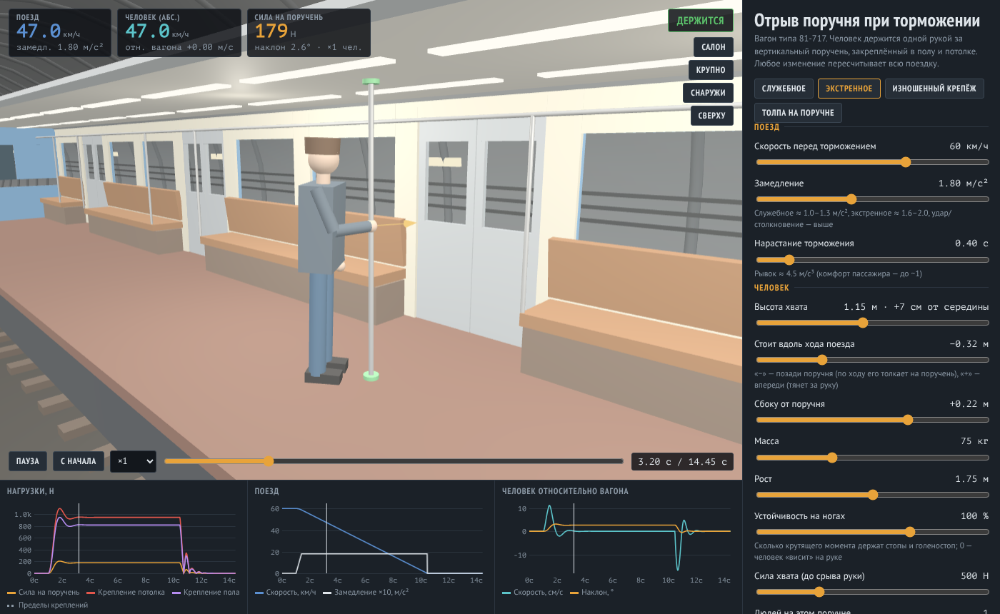
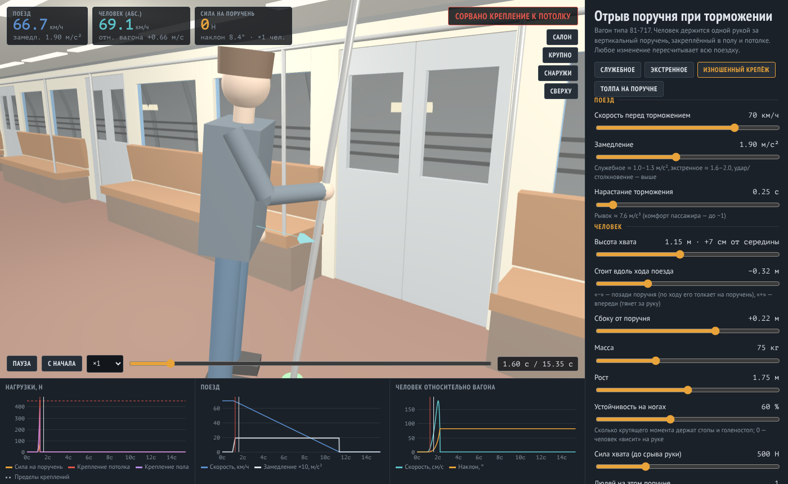
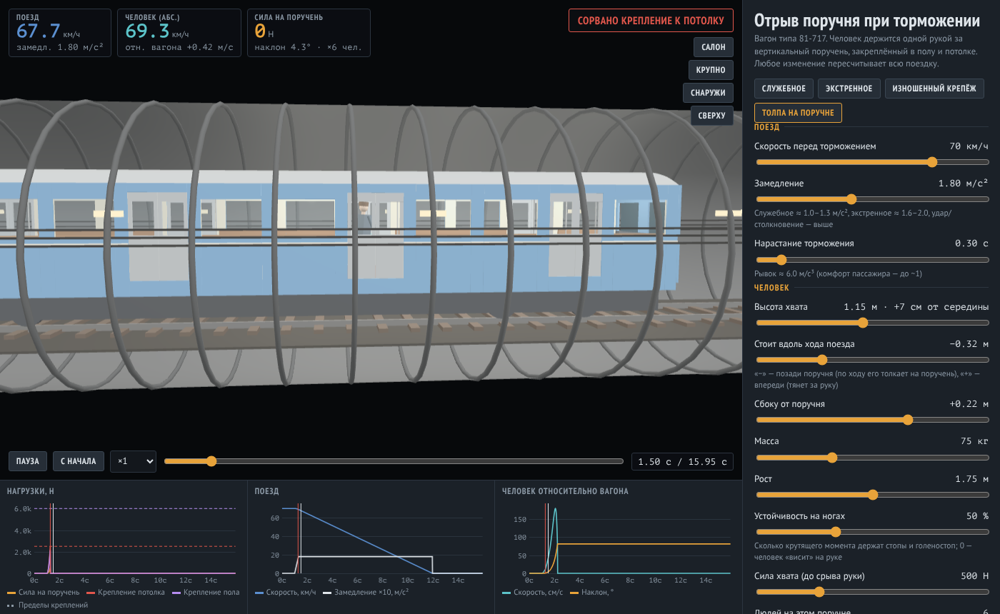

# Отрыв поручня метро

Интерактивная 3D-модель: человек держится одной рукой за вертикальный поручень в вагоне метро (тип 81-717) во время торможения поезда. Модель считает силу руки, нагрузки на крепления поручня к полу и потолку и показывает, когда соскальзывает рука или отрывается крепление.

**Онлайн-версия:** https://claude.ai/artifact/KyqvC39qhsUieU9XxfaqzT (доступ выдаёт владелец через меню Share)

## Запуск

Откройте `index.html` в браузере. Нужен интернет: Three.js загружается с jsDelivr. Сборка и сервер не нужны.

## Интерфейс

| Зона | Что там |
|---|---|
| 3D-вид | Вагон, человек, поручень, тоннель. Мышь: вращение, колесо — масштаб. Кнопки камеры: «Салон», «Крупно», «Снаружи», «Сверху» |
| Приборы (вверху слева) | Скорость поезда и замедление; абсолютная скорость человека и его скорость относительно вагона; горизонтальная сила на поручень и наклон тела |
| Статус (вверху справа) | Держится / рука сорвалась / сорвано крепление к потолку или полу / падение |
| Плеер (внизу) | Пауза, «С начала», скорость воспроизведения ×0.1…×4, перемотка по времени |
| Графики | Нагрузки на поручень и крепления с пределами прочности; скорость и замедление поезда; скорость и наклон человека относительно вагона |
| Пульт (справа) | Параметры, готовые сценарии, итог поездки |

Крепления в 3D подсвечиваются по загрузке: зелёный — меньше 60 % прочности, жёлтый — до 100 %, красный — оторвано. Оранжевая стрелка — сила руки на поручень, бирюзовая — скорость человека относительно вагона.

## Параметры

**Поезд**
- Скорость перед торможением, 5–90 км/ч.
- Замедление, 0,3–4 м/с². Служебное торможение ≈ 1,0–1,3, экстренное ≈ 1,6–2,0.
- Нарастание торможения, 0,03–3 с: за сколько секунд замедление выходит на полное значение. Чем меньше, тем резче; рывок (м/с³) показывается рядом.

**Человек**
- Высота хвата: показывается и как отступ от середины поручня (±см).
- Положение вдоль хода поезда: «−» — человек позади поручня, «+» — впереди.
- Положение сбоку от поручня.
- Масса, рост.
- Устойчивость на ногах: насколько стопы и голеностоп удерживают тело без руки.
- Сила хвата: при превышении рука соскальзывает.
- Людей на поручне: нагрузки складываются (все держатся одинаково).

**Поручень**
- Заделка концов: жёсткая (фланец на болтах) или шарнирная (труба в гнезде).
- Прочность креплений к потолку и к полу, Н.

**Сценарии:** служебное торможение, экстренное, изношенный крепёж, толпа на поручне.

## Как считается

1. **Поезд.** Замедление линейно нарастает до заданного за время нарастания и держится до остановки. В момент остановки оно снимается мгновенно, отсюда обратный толчок.
2. **Тело** — жёсткий перевёрнутый маятник, вращающийся вокруг стоп. На центр масс (0,55 роста) в системе вагона действуют сила инерции `m·a(t)` и гравитация. Голеностоп — упругий момент с ограничением: вперёд до `m·g·0,13 м`, назад до `m·g·0,07 м`.
3. **Рука** — пружина с демпфером от плеча (0,82 роста) до точки хвата. Растяжение 12 кН/м, сжатие 8 кН/м, демпфирование 500 Н·с/м. Сила в руке берётся из динамики, поэтому резкое торможение даёт пик больше статической силы.
4. **Поручень** — балка длиной `L = 2,15 м` с горизонтальной силой `F` на высоте `a` (`b = L − a`):
   - шарнирные концы: `R_пол = F·b/L`, `R_пот = F·a/L`;
   - жёсткие концы: `R_пол = F·b²(3a+b)/L³`, `M_пол = F·a·b²/L²`, для потолка симметрично.
   - Нагрузка на крепёж: `Q = R + M / 0,06 м` (момент переводится в усилие на болты фланца).
5. **Разрушение.** `Q > прочности` — крепление отрывается, поручень проворачивается вокруг уцелевшего конца. Сила в руке больше силы хвата — рука соскальзывает. Без опоры человек падает.

Интегрирование — полунеявный метод Эйлера с шагом 0,5 мс. Вся поездка считается заново при любом изменении параметра, а затем проигрывается.

## Допущения и ограничения

- Прочность креплений, жёсткость руки и параметры голеностопа — правдоподобные оценки, а не паспортные данные вагона.
- Шаг вперёд для удержания равновесия не моделируется; тело наклоняется только вдоль хода поезда.
- Собственный вес и изгиб поручня, а также вертикальная составляющая силы руки в нагрузках креплений не учитываются.
- Несколько людей на поручне считаются одинаковыми; в 3D нарисован один.
- Проскальзывание подошв не моделируется, только оценивается (μ ≈ 0,45) в итоге поездки.

## Вывод при значениях по умолчанию

Один человек исправный поручень не отрывает: при экстренном торможении нагрузка на потолочное крепление ≈ 1,1 кН, около четверти заданной прочности. Отрыв получается при изношенном крепеже или когда за поручень держится несколько человек.

## Файлы

- `index.html` — всё приложение (разметка, стили, физика, 3D).
- `docs/img/` — скриншоты для документации.
